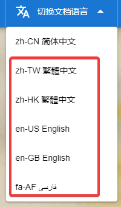
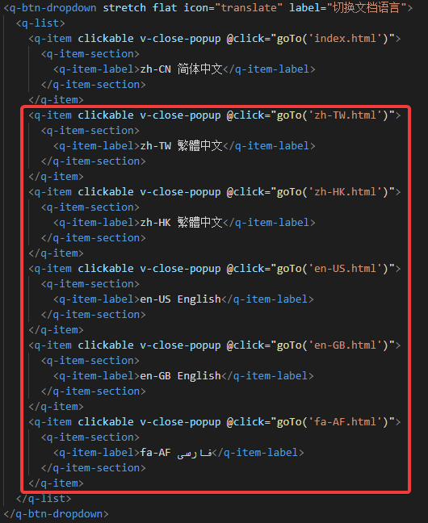

# octave_frida

Run Frida GumJS instrumentation scripts from GNU Octave.

```octave
pkg load octave_frida
frida_selftest ()

cfg = struct ('script', 'qrc_hook.js', 'target', 'LyricTools.exe', ...
              'mode', 'spawn', 'duration', 5);
r = frida_run (cfg);
msgs = frida_messages (r);
```

A system Python with `frida` installed is required on all platforms.  Install
it into the interpreter you want to use, for example `pip install frida`, and
set `FRIDA_PYTHON` if it is not found automatically.  No runtime is bundled.

## Documentation

Check out document: [octave_frida Document](https://cnoctave.github.io/octave_frida/index.html)

## How to translate octave_frida Document into another language
In ./docs directory, index.html is zh-CN simplified Chinese document.
For example, if you want to translate document into English.
1. Copy index.html as another document with different language code as filename,
   for example, en-US.html.
2. Translate en-US.html into English.
3. Add dropdown like the picture below to every *.html.
   For example, add dropdown "en-US English".
   
   The code for adding dropdown is like the picture below.
   
4. PR to octave_frida.
